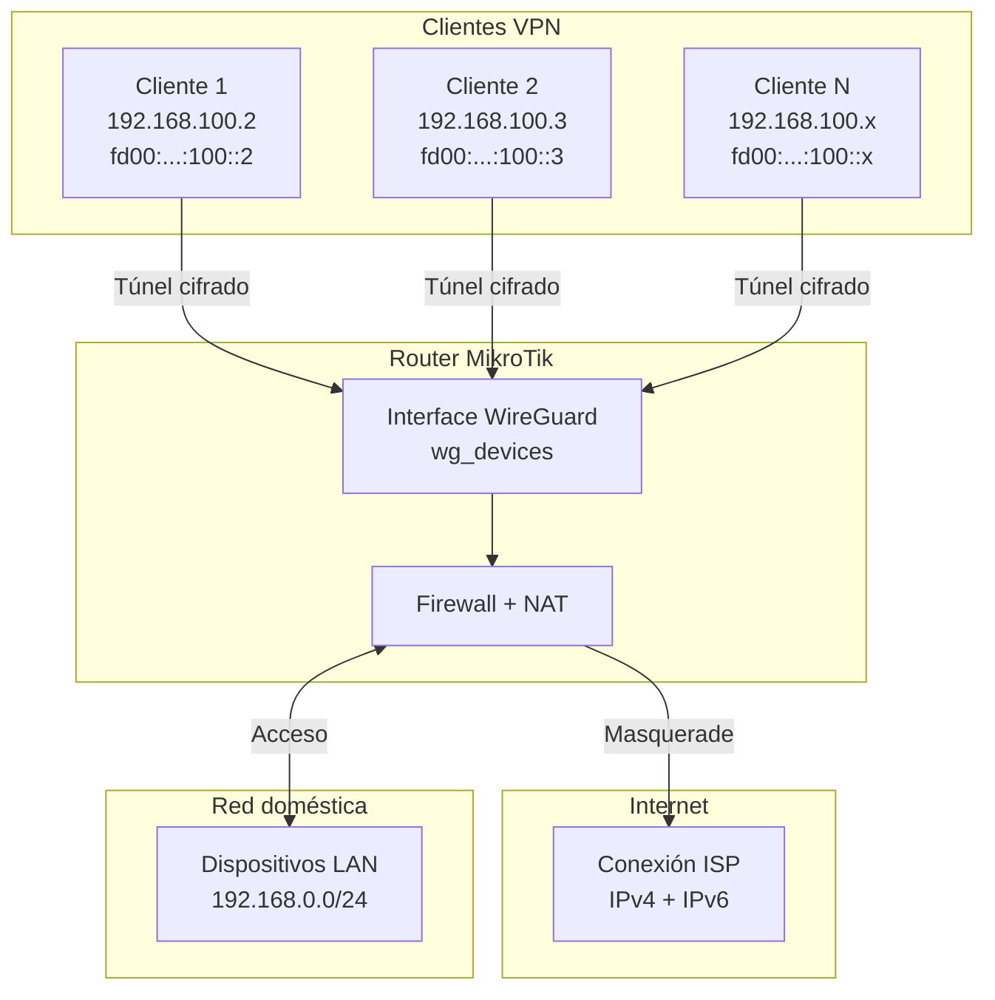
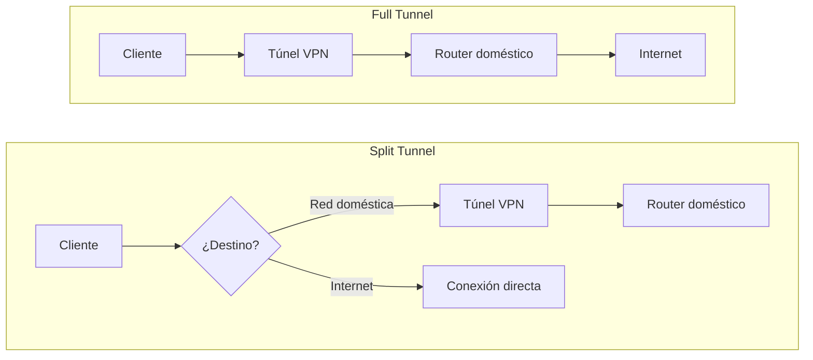

import Callout from "@components/ui/Callout.astro";
import FileContent from "@components/ui/FileContent.astro";
import Mermaid from "@components/ui/Mermaid.astro";
import TerminalCommand from "@components/ui/TerminalCommand.astro";
import {
  TerminalSession,
  TerminalSessionCommand,
  TerminalSessionOutput,
} from "@components/ui/terminal-session";
import Table from "@components/ui/Table.astro";
import Code from "@components/ui/Code.astro";
import CheckList from "@components/ui/CheckList.astro";
import TLDRSummary from "@components/ui/TLDRSummary.astro";
import Prerequisite from "@components/ui/Prerequisite.astro";
import { Tabs, TabPanel } from "@components/ui/tabs";
import Collapsible from "@components/ui/Collapsible.astro";

{/* cspell:ignore XLAT CLAT mtumonitor */}

[WireGuard](https://www.wireguard.com/) ha revolucionado la tecnología VPN con su simplicidad, velocidad y criptografía moderna. A diferencia de protocolos VPN tradicionales como [OpenVPN](https://openvpn.net/) o [IPSec](https://datatracker.ietf.org/doc/html/rfc7296), WireGuard utiliza una base de código mínima (~4.000 líneas frente a más de 100.000) y primitivas criptográficas de última generación, tal como se describe en el [whitepaper de WireGuard](https://www.wireguard.com/papers/wireguard.pdf), lo que se traduce en conexiones más rápidas y menor latencia.

Esta guía muestra cómo configurar un **WireGuard VPN listo para producción** en MikroTik RouterOS con **soporte dual-stack IPv4/IPv6**. ¿El resultado? Puedes conectarte desde cualquier red, incluso desde una sin IPv6, y disfrutar de conectividad IPv6 completa a través de tu router doméstico.

<TLDRSummary title="TL;DR: WireGuard dual-stack en RouterOS">
  - **WireGuard viene integrado en RouterOS 7**, así que un servidor VPN dual-stack no necesita contenedor ni paquete adicional. La interfaz escucha en un puerto UDP alto no estándar (**53537** aquí, no el 51820 por defecto, para esquivar los escaneos automáticos) y cada peer recibe una dirección IPv4 y una IPv6.
  - **El IPv6 va por ULA más NAT66, no por prefijo delegado.** Los clientes reciben direcciones `fd00::/8` que el router traduce al prefijo global de tu ISP, de modo que el túnel sobrevive a que ese prefijo cambie por debajo.
  - **Dimensiona el túnel desde el WAN y limita el MSS por familia.** El MTU del túnel es el `actual-mtu` de tu WAN menos 60 (endpoint solo IPv4 y clientes que no cambian de red) o menos 80 (endpoint IPv6 o dual-stack): 1400 en mi enlace PPPoE de 1480, 1420 en uno de 1500. Después, dos reglas de MSS clamping, `/ip` al MTU − 40 y `/ipv6` al MTU − 60, y `MTU =` en la configuración de cada cliente, porque iOS y Android usan 1280 si falta.
  - **El router contesta y el cliente mantiene vivo el túnel.** Los peers llevan `responder=yes`, así que el router no se queda intentando handshakes contra el endpoint muerto de un cliente itinerante; el `PersistentKeepalive = 25` va en el cliente, que es el lado que está detrás de NAT.
  - **Cada dispositivo tiene su propio par de claves y su par de direcciones.** Revocar un cliente es borrar un peer; no hay que reemitir nada más.
  - **El split tunnel se decide en el `AllowedIPs` del cliente**, no en el servidor: lista solo los prefijos de casa para encaminar el tráfico doméstico, o `0.0.0.0/0, ::/0` para encaminarlo todo.
  - **Probado en RouterOS 7.25 sobre un RB5009.** El mínimo es la 7.17, la primera versión en la que `responder=yes` impide que el router inicie handshakes; `client-allowed-address` necesita la 7.21 y `client-mtu`, la 7.25, y los dos son opcionales.
</TLDRSummary>

<Callout type="important" title="Valores que debes personalizar">
A lo largo de esta guía, los valores que **debes sustituir** por los tuyos están claramente marcados. Busca:

- **`wg_devices`**: nombre de la interfaz WireGuard (personalízalo si prefieres otro nombre)
- **`53537`**: puerto de escucha de WireGuard (elige cualquier puerto UDP no utilizado)
- **`mtu=1400`**: MTU del túnel, el `actual-mtu` de tu WAN menos 80 (1400 es para mi enlace PPPoE de 1480; el [Paso 7](#paso-7-calcular-el-mtu-y-limitar-el-mss) explica cómo calcular el tuyo). Los valores que dependen de él cambian también: los MSS de las reglas de clamping, `1360` (IPv4) y `1340` (IPv6), y el `MTU = 1400` de las configuraciones de cliente
- **`192.168.100.0/24`**: subred IPv4 de la VPN (cámbiala si entra en conflicto con tu red)
- **`fd00:1111:2222:100::/64`**: prefijo ULA IPv6 de la VPN (genera el tuyo en [unique-local-ipv6.com](https://www.unique-local-ipv6.com/))
- **`192.168.0.0/24`**: subred de tu LAN doméstica (ajústala a tu red)
- **Claves de cliente**: genera siempre pares de claves únicos por dispositivo
- **`your-domain.com`**: tu IP pública o nombre de host DDNS
</Callout>

---

## ¿WireGuard en RouterOS admite IPv6?

Sí. WireGuard viene integrado en RouterOS 7 como un tipo de interfaz más y
transporta IPv6 de forma nativa: asignas una dirección IPv6 a la interfaz WireGuard
y das a cada peer su propia `allowed-address` IPv6. La pega está en el
direccionamiento: esta guía usa un prefijo ULA con NAT66 en lugar de un prefijo
delegado, para que el túnel sobreviva a los cambios de prefijo de tu ISP.

---

## Cómo lo ejecuto en mi propia infraestructura

La configuración de esta guía no es un ejercicio de laboratorio: es el WireGuard que tengo en marcha en mi propio RB5009UG+S+ con RouterOS 7.25, con la misma disposición de interfaces que esta guía. Mi WAN es el PPPoE de DIGI, que negocia `actual-mtu=1480` (la [guía del PPPoE de DIGI](/es/blog/008-mikrotik-pppoe-dualstack-digi/) explica por qué es 1480 y no 1500), así que todos los valores de MTU y MSS de esta guía son los de ese enlace: MTU del túnel 1400, MSS 1360 para IPv4 y 1340 para IPv6. La versión de RouterOS con la que se comprobó cada guía por última vez está sellada al principio de su propia página, y por eso el mismo router aparece con una versión distinta aquí y en [la guía del honeypot](/es/blog/006-implementing-mikrotik-honeypot/).

Llegar a esos valores no fue un camino recto. El 8 de septiembre de 2026 bajé el túnel a MTU 1400 y el MSS clamping de IPv4 a `new-mss=1340`, sin añadir ninguna regla para IPv6. A las 03:10 de la madrugada siguiente devolví el MTU a 1500 desde el móvil, porque notaba problemas que nunca llegué a concretar, y el 11 de septiembre revertí también el clamping. Mi mejor explicación, que no he demostrado, es el IPv6: el único clamping de IPv6 del router era una regla genérica a 1348, y un paquete TCP IPv6 que lleva un segmento de 1348 bytes ocupa 1408 bytes (1348 + 40 + 20), que no caben en un túnel de 1400. Solo pasa si el «Packet Too Big» de ICMPv6 llega al servidor de origen y este reacciona; si no, la descarga se queda colgada. Eso afectaría a los clientes cuyo propio MTU supera los 1400 (los Mac, a 1420 en modo automático, y un router mesh Deco), y no al iPhone, que se queda en 1280. El 7 de noviembre de 2026 volví a aplicar los valores, esta vez con la regla de IPv6 del Paso 7, y los medí: las cifras están en [Lo que medí en mi router](#lo-que-medí-en-mi-router).

El consejo del keepalive tiene su propia historia. El 27 de octubre de 2026 vi que el router repetía intentos de handshake cada ~5 segundos hacia direcciones que ya no contestaban: las del Deco, apagado desde el 19 de septiembre, y las de un MacBook. Eso suponía unas 1.140 líneas de log por hora en Loki, y los dos peers tenían `persistent-keepalive` puesto en el lado del router. Lo quité de ahí y dejé el keepalive en los clientes; la propiedad que RouterOS documenta para decirle a un peer que nunca inicie es `responder=yes`, que es la que usa el [Paso 9](#paso-9-añadir-peers-wireguard-clientes).

---

## ¿Por qué WireGuard en MikroTik?

<Table title="Comparativa de protocolos VPN">
  <thead>
    <tr>
      <th scope="col">Característica</th>
      <th scope="col">WireGuard</th>
      <th scope="col">OpenVPN</th>
      <th scope="col">IPSec/IKEv2</th>
    </tr>
  </thead>
  <tbody>
    <tr>
      <td>Complejidad de código</td>
      <td>~4.000 líneas</td>
      <td>~100.000 líneas</td>
      <td>~400.000 líneas</td>
    </tr>
    <tr>
      <td>Tiempo de conexión</td>
      <td>100ms</td>
      <td>3-10 segundos</td>
      <td>1-3 segundos</td>
    </tr>
    <tr>
      <td>Carga de CPU</td>
      <td>Muy baja</td>
      <td>Alta (espacio de usuario)</td>
      <td>Media</td>
    </tr>
    <tr>
      <td>Criptografía</td>
      <td>ChaCha20, Curve25519</td>
      <td>Configurable (varía)</td>
      <td>AES, RSA/ECDH</td>
    </tr>
    <tr>
      <td>Soporte de roaming</td>
      <td>Transparente</td>
      <td>Necesita reconexión</td>
      <td>Limitado (MOBIKE)</td>
    </tr>
  </tbody>
</Table>

<Callout type="tip" title="Diseñado para móviles">
WireGuard destaca en dispositivos móviles. Cuando cambias de Wi-Fi a datos móviles o de red, WireGuard reconecta instantáneamente sin perder la sesión. Esta capacidad de roaming lo hace ideal para smartphones y portátiles.
</Callout>

---

## ¿Cómo encajan las mitades IPv4 e IPv6?

Nuestra configuración crea una VPN dual-stack en la que los clientes conectados reciben tanto dirección IPv4 como IPv6. El tráfico de los clientes se traduce mediante NAT (masquerade) para acceder a internet a través de tu conexión doméstica. Para más información, consulta la [documentación oficial de WireGuard en MikroTik](https://help.mikrotik.com/docs/spaces/ROS/pages/69664792/WireGuard).

<Mermaid caption="Arquitectura WireGuard Dual-Stack" ariaLabel="Diagrama que muestra la topología VPN WireGuard con redes IPv4 e IPv6 pasando a través del router MikroTik hacia internet" maxWidth="600px">

</Mermaid>

### Esquema de direccionamiento

<Table title="Asignación de direcciones IP">
  <thead>
    <tr>
      <th scope="col">Componente</th>
      <th scope="col">Dirección IPv4</th>
      <th scope="col">Dirección IPv6</th>
    </tr>
  </thead>
  <tbody>
    <tr>
      <td>Interface WireGuard (Router)</td>
      <td>`192.168.100.1/24`</td>
      <td>`fd00:1111:2222:100::1/64`</td>
    </tr>
    <tr>
      <td>Rango de clientes VPN</td>
      <td>`192.168.100.2-254`</td>
      <td>`fd00:1111:2222:100::2-ffff`</td>
    </tr>
    <tr>
      <td>LAN doméstica</td>
      <td>`192.168.0.0/24`</td>
      <td>Prefix asignado por el ISP</td>
    </tr>
  </tbody>
</Table>

<Callout type="info" title="¿Por qué ULA para IPv6?">
Utilizamos [direcciones Unique Local (ULA)](https://datatracker.ietf.org/doc/html/rfc4193) del rango `fd00::/8` para la VPN. Estas direcciones son privadas (como RFC1918 para IPv4) y no entran en conflicto con direcciones IPv6 públicas. El router las traduce mediante NAT66 al prefijo IPv6 global asignado por tu ISP.
</Callout>

---

## Requisitos previos

<Prerequisite title="Antes de empezar">
  - **MikroTik RouterOS 7.17** o posterior (WireGuard viene integrado desde RouterOS 7; las propiedades `client-*` del peer, de las que sale el código QR, llegaron en la 7.12, y con `responder=yes` el router deja de iniciar handshakes desde la 7.17. `client-allowed-address` necesita la 7.21 y `client-mtu`, la 7.25, los dos opcionales)
  - **Dirección IP pública** (estática) o **Dynamic DNS** (DDNS) configurado en tu router
  - **Conectividad IPv6** desde tu ISP (opcional pero recomendada para dual-stack)
  - **Capacidad de reenvío de puertos UDP** si tu MikroTik está detrás de otro router/NAT
  - **Acceso administrativo** a tu router MikroTik (vía WinBox, WebFig o SSH)
  - **Listas de interfaces** ya creadas: `WAN` (para interfaces de cara a internet) y `LAN` (para interfaces de red local). Forman parte de la configuración por defecto de MikroTik
</Prerequisite>

---

## Paso 1: crear la interfaz WireGuard

Primero, creamos la interfaz WireGuard en el router MikroTik. El router generará un par de claves automáticamente.

<Code lang="routeros" title="Crear interfaz WireGuard">
```routeros
/interface wireguard add \
    name=wg_devices \
    mtu=1400 \
    listen-port=53537 \
    comment="VPN for Mobile Devices"
```
</Code>

`mtu=1400` es para mi WAN, un enlace PPPoE de DIGI que negocia `actual-mtu=1480`. El [Paso 7](#paso-7-calcular-el-mtu-y-limitar-el-mss) explica cómo calcular el tuyo: el `actual-mtu` de tu WAN menos 80, que da 1420 en un WAN de 1500, el mismo valor que RouterOS usa por defecto.

<Callout type="tip" title="Selección de puerto">
Usar un puerto no estándar como `53537` en lugar del `51820` por defecto ayuda a evitar escaneos automatizados dirigidos a puertos VPN conocidos. Algunas redes también bloquean puertos VPN estándar, así que un puerto alto aleatorio puede ofrecer mejor conectividad.
</Callout>

### Obtener la public key del servidor

Tras crear la interfaz, obtén la public key para configurar los clientes:

<TerminalSession title="Obtener Public Key del servidor">
  <TerminalSessionCommand>
    /interface wireguard print
  </TerminalSessionCommand>
  <TerminalSessionOutput title="Salida">

```
Flags: X - disabled; R - running
 0  R name="wg_devices" mtu=1400 listen-port=53537
      private-key="[REDACTED]"
      public-key="YourServerPublicKeyHere123456789ABCDEFGHIJ="
```

  </TerminalSessionOutput>
</TerminalSession>

Guarda el valor de `public-key`: lo necesitarás al configurar los dispositivos cliente.

---

## Paso 2: asignar direcciones IP a la interfaz

La interfaz WireGuard necesita tanto dirección IPv4 como IPv6 para servir como gateway de los clientes VPN.

<Code lang="routeros" title="Asignar direcciones IP">
```routeros
# IPv4 address for WireGuard interface
/ip address add \
    address=192.168.100.1/24 \
    interface=wg_devices \
    network=192.168.100.0 \
    comment="VPN Devices Network"

# IPv6 ULA address for WireGuard interface
/ipv6 address add \
    address=fd00:1111:2222:100::1/64 \
    interface=wg_devices \
    advertise=no \
    comment="VPN Devices IPv6 ULA"
```
</Code>

<Callout type="warning" title="Ajuste de advertise en IPv6">
Establece `advertise=no` para la dirección IPv6 de WireGuard. No queremos Router Advertisements en el túnel VPN: los clientes reciben sus direcciones estáticas a través de la configuración de WireGuard, no por SLAAC.
</Callout>

---

## Paso 3: crear pool IPv6 (opcional)

Si quieres gestionar la asignación de direcciones IPv6 de forma centralizada, crea un pool:

<Code lang="routeros" title="Crear pool IPv6">
```routeros
/ipv6 pool add \
    name=wg_devices_pool_global \
    prefix=fd00:1111:2222:100::/64 \
    prefix-length=64 \
    comment="WireGuard Devices Global IPv6 Pool"
```
</Code>

---

## Paso 4: añadir la interfaz a las listas de interfaces

MikroTik utiliza listas de interfaces para las reglas de firewall. Añadir WireGuard a las listas adecuadas garantiza una gestión correcta del tráfico.

<Code lang="routeros" title="Añadir a listas de interfaces">
```routeros
# Add to VPN list for VPN-specific rules
/interface list member add \
    interface=wg_devices \
    list=VPN \
    comment="VPN Devices"

# Add to LAN list to allow access to local resources
/interface list member add \
    interface=wg_devices \
    list=LAN \
    comment="VPN Devices - LAN Access"
```
</Code>

---

## Paso 5: configurar reglas de firewall

La configuración del firewall es crítica para la seguridad y la conectividad. Necesitamos reglas para:

1. **Aceptar tráfico WireGuard** en el puerto de escucha
2. **Permitir a los clientes VPN** acceder a internet
3. **Permitir a los clientes VPN** acceder a las redes locales
4. **NAT/Masquerade** para el tráfico saliente

<Callout type="warning" title="Ubicación de las reglas de firewall">
MikroTik procesa las reglas de firewall **de arriba a abajo**. Las reglas siguientes deben colocarse **antes** de cualquier regla `drop` en sus respectivas cadenas. Usa el parámetro `place-before` o reordena las reglas en WinBox después de añadirlas.

Si usas el firewall por defecto de MikroTik, añade estas reglas cerca del inicio de cada cadena, después de las reglas `established,related` de aceptación.
</Callout>

### Cadena input: aceptar conexiones WireGuard

<Code lang="routeros" title="Reglas de firewall input">
```routeros
# Allow WireGuard UDP port (IPv4)
/ip firewall filter add \
    chain=input \
    action=accept \
    protocol=udp \
    dst-port=53537 \
    comment="WireGuard - Accept incoming connections"

# Allow WireGuard UDP port (IPv6)
/ipv6 firewall filter add \
    chain=input \
    action=accept \
    protocol=udp \
    port=53537 \
    comment="Allow WireGuard"
```
</Code>

### Cadena forward: permitir tráfico VPN

<Code lang="routeros" title="Reglas de firewall forward - IPv4">
```routeros
# FastTrack for established WireGuard connections (performance)
/ip firewall filter add \
    chain=forward \
    action=fasttrack-connection \
    connection-state=established,related \
    src-address-list=WireGuard \
    comment="FastTrack for WireGuard Networks"

# Allow VPN clients to internet
/ip firewall filter add \
    chain=forward \
    action=accept \
    src-address=192.168.100.0/24 \
    out-interface-list=WAN \
    comment="Allow WireGuard Devices to Internet"

# Allow return traffic from internet to VPN
/ip firewall filter add \
    chain=forward \
    action=accept \
    connection-state=established,related \
    dst-address=192.168.100.0/24 \
    in-interface-list=WAN \
    comment="Allow Internet to WireGuard Devices (replies)"

# Allow VPN clients to Home LAN
/ip firewall filter add \
    chain=forward \
    action=accept \
    src-address=192.168.100.0/24 \
    dst-address=192.168.0.0/24 \
    comment="Allow WireGuard Devices to Home LAN"
```
</Code>

<Code lang="routeros" title="Reglas de firewall forward - IPv6">
```routeros
# Allow VPN clients all outbound IPv6 traffic
/ipv6 firewall filter add \
    chain=forward \
    action=accept \
    in-interface=wg_devices \
    comment="WireGuard Devices: Allow all outbound"

# Allow return IPv6 traffic to VPN clients
/ipv6 firewall filter add \
    chain=forward \
    action=accept \
    connection-state=established,related \
    out-interface=wg_devices \
    comment="WireGuard Devices: Allow replies"
```
</Code>

### Crear address list para redes WireGuard

<Code lang="routeros" title="Listas de direcciones">
```routeros
/ip firewall address-list add \
    list=WireGuard \
    address=192.168.100.0/24 \
    comment="WireGuard Devices Network"
```
</Code>

---

## Paso 6: configurar NAT/Masquerade

Para que los clientes VPN accedan a internet, sus direcciones privadas deben traducirse (NAT) a tu IP pública.

<Code lang="routeros" title="Configuración NAT">
```routeros
# IPv4 Masquerade for WireGuard
/ip firewall nat add \
    chain=srcnat \
    action=masquerade \
    src-address=192.168.100.0/24 \
    out-interface-list=WAN \
    comment="WireGuard Devices - Internet Access"

# IPv6 NAT66 for WireGuard (ULA to Global)
/ipv6 firewall nat add \
    chain=srcnat \
    action=masquerade \
    src-address=fd00:1111:2222:100::/64 \
    out-interface-list=WAN \
    comment="WireGuard Devices - IPv6 Internet Access"
```
</Code>

<Callout type="info" title="NAT66 explicado">
La filosofía tradicional de IPv6 desaconseja el NAT, prefiriendo la conectividad extremo a extremo. Sin embargo, NAT66 (masquerade para IPv6) resulta práctico en VPNs que usan direcciones ULA. Tus clientes VPN utilizan direcciones ULA privadas, que se traducen al [prefijo IPv6 global asignado por tu ISP](/es/blog/008-mikrotik-pppoe-dualstack-digi/) cuando acceden a internet.
</Callout>

---

## Paso 7: calcular el MTU y limitar el MSS

WireGuard envuelve cada paquete que un cliente envía o recibe en un paquete exterior nuevo y cifrado, y es ese paquete exterior el que tiene que caber por tu WAN. Por eso el MTU del túnel sale del WAN, y no al revés, y RouterOS no lo calcula por ti: la interfaz usa el `mtu` que le des, aunque sus paquetes exteriores no quepan. Un paquete exterior demasiado grande se fragmenta en la capa IP, lo que cuesta CPU en los dos extremos y falla en los caminos que descartan fragmentos. El MSS clamping de TCP se encarga después de que los segmentos TCP quepan en ese MTU.

### Lo que WireGuard añade a cada paquete

Cada paquete de datos de WireGuard es el paquete interior cifrado entre una cabecera fija (IP exterior, UDP y la cabecera de datos de WireGuard) y un cierre fijo (la etiqueta Poly1305). Todo lo que no es el paquete interior es sobrecarga, y el MTU del túnel es el tamaño del paquete interior más grande:

<Table title="Sobrecarga de WireGuard en bytes, según la familia exterior">
  <thead>
    <tr>
      <th scope="col">Parte</th>
      <th scope="col">IPv4 exterior</th>
      <th scope="col">IPv6 exterior</th>
    </tr>
  </thead>
  <tbody>
    <tr>
      <td>Cabecera IP exterior</td>
      <td>20</td>
      <td>40</td>
    </tr>
    <tr>
      <td>Cabecera UDP</td>
      <td>8</td>
      <td>8</td>
    </tr>
    <tr>
      <td>Cabecera de datos de WireGuard (tipo, índice del receptor, contador)</td>
      <td>16</td>
      <td>16</td>
    </tr>
    <tr>
      <td>Etiqueta de autenticación Poly1305</td>
      <td>16</td>
      <td>16</td>
    </tr>
    <tr>
      <td>**Sobrecarga total**</td>
      <td>**60**</td>
      <td>**80**</td>
    </tr>
  </tbody>
</Table>

### La familia exterior fija el MTU y la interior, el MSS

<Code lang="text" title="MTU del túnel y MSS">
```text
path MTU    = min(server WAN MTU, client-side path MTU)
tunnel MTU  = path MTU - overhead(outer family)   # 60 for IPv4, 80 for IPv6
MSS (IPv4)  = tunnel MTU - 40                     # 20 IPv4 + 20 TCP
MSS (IPv6)  = tunnel MTU - 60                     # 40 IPv6 + 20 TCP
```
</Code>

Aquí intervienen dos familias de direcciones, y cada una decide una cosa distinta:

- **La familia exterior** es la del paquete cifrado que cruza internet entre el cliente y tu WAN. Decide la sobrecarga (60 u 80) y, por tanto, el **MTU**.
- **La familia interior** es la de tu tráfico dentro del túnel. Decide **qué MSS** se aplica (MTU − 40 para IPv4, MTU − 60 para IPv6) y **en qué tabla va la regla de clamping**: `/ip firewall mangle` para IPv4 y `/ipv6 firewall mangle` para IPv6. `/ip firewall mangle` nunca ve un paquete IPv6, así que un túnel dual-stack necesita las dos reglas.

### Valores de referencia para los enlaces WAN habituales

<Table title="MTU del túnel y MSS según el MTU del WAN y la familia exterior">
  <thead>
    <tr>
      <th scope="col">MTU del WAN</th>
      <th scope="col">Familia exterior</th>
      <th scope="col">MTU del túnel</th>
      <th scope="col">MSS, IPv4 interior</th>
      <th scope="col">MSS, IPv6 interior</th>
    </tr>
  </thead>
  <tbody>
    <tr>
      <td>1500 (Ethernet, fibra)</td>
      <td>IPv4</td>
      <td>1440</td>
      <td>1400</td>
      <td>1380</td>
    </tr>
    <tr>
      <td>1500 (Ethernet, fibra)</td>
      <td>IPv6</td>
      <td>**1420**</td>
      <td>1380</td>
      <td>1360</td>
    </tr>
    <tr>
      <td>1492 (PPPoE estándar)</td>
      <td>IPv4</td>
      <td>1432</td>
      <td>1392</td>
      <td>1372</td>
    </tr>
    <tr>
      <td>1492 (PPPoE estándar)</td>
      <td>IPv6</td>
      <td>**1412**</td>
      <td>1372</td>
      <td>1352</td>
    </tr>
    <tr>
      <td>1480 (PPPoE de DIGI, el mío)</td>
      <td>IPv4</td>
      <td>1420</td>
      <td>1380</td>
      <td>1360</td>
    </tr>
    <tr>
      <td>1480 (PPPoE de DIGI, el mío)</td>
      <td>IPv6</td>
      <td>**1400**</td>
      <td>**1360**</td>
      <td>**1340**</td>
    </tr>
  </tbody>
</Table>

Los MTU en negrita son los de las filas de IPv6, los que hay que usar cuando algún cliente puede llegar a tu endpoint por IPv6, que en una instalación dual-stack es lo normal. La última fila es la que usa esta guía.

### Cómo saber el MTU real de tu WAN

<Code lang="routeros" title="Leer el MTU negociado del WAN">
```routeros
/interface print detail where name=<your-wan>
# Read actual-mtu, not the max-mtu you configured
```
</Code>

Fíate del `actual-mtu`, no del `max-mtu` que configuraste: el mío dice `max-mtu=1500` y negocia 1480. PPPoE mete una cabecera de 8 bytes dentro de la carga útil de 1500 bytes de Ethernet, lo que deja 1492 en un enlace PPPoE estándar; 1480 es lo que negocia el servidor de DIGI, como explica la [guía del PPPoE de DIGI](/es/blog/008-mikrotik-pppoe-dualstack-digi/).

### Qué familia exterior suponer

La familia exterior la decide el `Endpoint` al que llama cada cliente, no lo que el túnel transporta dentro:

<Table title="Familia exterior según el endpoint del cliente">
  <thead>
    <tr>
      <th scope="col">`Endpoint` del cliente</th>
      <th scope="col">Familia exterior posible</th>
      <th scope="col">Sobrecarga que suponer</th>
    </tr>
  </thead>
  <tbody>
    <tr>
      <td>Un nombre con solo registro A, o una IPv4 literal</td>
      <td>Siempre IPv4</td>
      <td>60</td>
    </tr>
    <tr>
      <td>Un nombre con registros A y AAAA, un nombre con solo AAAA, o una IPv6 literal</td>
      <td>IPv4 o IPv6, según la red en la que esté el cliente</td>
      <td>80</td>
    </tr>
  </tbody>
</Table>

Los dispositivos que cambian de red necesitan un matiz más. En las redes móviles solo IPv6 con 464XLAT (CLAT), una conexión a un endpoint IPv4 viaja como IPv6 por el tramo radio, 20 bytes más grande, y algunas redes móviles ya tienen de partida un MTU por debajo de 1500. Para móviles y portátiles lo prudente es la fila de 80 bytes aunque el endpoint sea solo IPv4; un cliente fijo cuyo endpoint solo tiene registro A puede usar la de 60.

### Qué controla cada extremo del túnel

<Table title="Qué controla el MTU de cada extremo">
  <thead>
    <tr>
      <th scope="col">Ajuste</th>
      <th scope="col">Controla</th>
      <th scope="col">Valor que usar</th>
    </tr>
  </thead>
  <tbody>
    <tr>
      <td>MTU de la interfaz del servidor (`mtu=` en `/interface wireguard`)</td>
      <td>Todo lo que el router envía a los clientes: TCP, UDP y QUIC, DNS, VoIP</td>
      <td>Un solo valor para todos los peers de la interfaz, aunque cada peer puede usar una familia exterior distinta y cambiarla al cambiar de red. Toma el peor caso: WAN − 80 si algún peer puede llegar por IPv6, y WAN − 60 solo si todos los endpoints tienen únicamente registro A y ningún cliente cambia de red. Para dar aun así el valor de 60 a los clientes fijos con endpoint de solo registro A, ponlos en una segunda interfaz.</td>
    </tr>
    <tr>
      <td>MTU del cliente (`MTU =` en el `.conf`, o `client-mtu` en el peer de RouterOS)</td>
      <td>Todo lo que envía el cliente, más el MSS que anuncia en sus SYN, que limita lo que TCP le envía</td>
      <td>min(WAN del servidor, enlace del cliente) − la sobrecarga de la familia de *su* endpoint. Con mi WAN de 1480: mi iPhone, con un nombre con registros A y AAAA, usa 1400; un Mac con un nombre con solo registro A funciona a 1420 (lo que elige macOS por su cuenta en un enlace de 1500), y también a 1400.</td>
    </tr>
    <tr>
      <td>MSS clamping en el router (dos reglas, `/ip` y `/ipv6`)</td>
      <td>Solo TCP. Cubre a los clientes cuyo MTU es mayor que el del servidor</td>
      <td>Los valores de la tabla de referencia para la fila del servidor</td>
    </tr>
  </tbody>
</Table>

De aquí salen unas cuantas reglas:

- **Los dos extremos no tienen por qué compartir MTU.** Cada uno limita lo que envía. Lo que no puede pasar es que alguno supere el MTU de su camino menos la sobrecarga.
- **`change-mss` solo baja, nunca sube.** Es un tope, así que la regla solo debe aplicarse a los SYN que anuncien más que el valor nuevo: `tcp-mss=<new-mss + 1>-65535`. Con `new-mss=1360` el rango es `1361-65535`, y un SYN que ya anuncia 1240 pasa sin tocarse.
- **El MSS clamping no arregla UDP.** QUIC (HTTP/3), DNS y VoIP dependen del MTU de la interfaz y del descubrimiento del MTU del camino, y por eso el MTU del servidor tiene que estar bien aunque haya clamping.
- **IPv6 necesita al menos 1280.** El [RFC 8200](https://datatracker.ietf.org/doc/html/rfc8200#section-5) exige que todo enlace transporte paquetes de 1280 bytes, así que si la fórmula da menos de 1280 y el túnel lleva IPv6 dentro, IPv6 no funcionará por él.
- **Con `in-interface=wg_devices`, la regla de clamping actúa sobre el SYN y el SYN-ACK que llegan del cliente**: las conexiones que abre el cliente y las que se abren hacia él desde la LAN. Es todo lo que necesita el router, porque solo tiene que limitar lo que envía al túnel; lo que envía el cliente ya lo limita su propio MTU.

### Añadir las dos reglas de MSS clamping

<Code lang="routeros" title="MSS clamping para IPv4 e IPv6">
```routeros
/ip firewall mangle add \
    chain=forward \
    action=change-mss \
    protocol=tcp \
    tcp-flags=syn \
    tcp-mss=1361-65535 \
    new-mss=1360 \
    in-interface=wg_devices \
    comment="WireGuard MSS clamping - Devices"

/ipv6 firewall mangle add \
    chain=forward \
    action=change-mss \
    protocol=tcp \
    tcp-flags=syn \
    tcp-mss=1341-65535 \
    new-mss=1340 \
    in-interface=wg_devices \
    comment="WireGuard MSS clamping IPv6 - Devices"
```
</Code>

Los valores son el MTU − 40 y el MTU − 60 de mi túnel de 1400; toma los tuyos de la tabla de referencia y haz que cada rango `tcp-mss` empiece uno por encima de su `new-mss`. Las reglas mangle llevan `passthrough=yes` por defecto, así que ninguna de las dos detiene el resto de la cadena.

### Lo que medí en mi router

El 7 de noviembre de 2026 medí tres configuraciones desde un iPhone 12 Pro Max con la app oficial de WireGuard, conectado a la Wi-Fi de otra línea de DIGI y llegando al router por IPv4. Cada fila es un test de velocidad lanzado desde el móvil. A la vez, el sniffer del router sobre `wg_devices` (solo cabeceras) registró el tamaño de los paquetes, y [mikroscope](https://docs.jmrp.io/mikroscope/es/), mi telemetría de kernel con resolución por debajo del segundo para RouterOS, que corre en un contenedor en el propio router, registró el tiempo de softirq y el `time_squeeze` a partir de los contadores del propio kernel. Sus cifras solo cuentan los segundos con más de 50 Mbps en `wg_devices`.

<Table title="El mismo móvil, el mismo router, tres ajustes de MTU">
  <thead>
    <tr>
      <th scope="col">Escenario</th>
      <th scope="col">Router: MTU del túnel / clamping</th>
      <th scope="col">MTU del iPhone</th>
      <th scope="col">Test de velocidad ↓ / ↑ (Mbps)</th>
      <th scope="col">Ticks de softirq/s</th>
      <th scope="col">time_squeeze/s</th>
    </tr>
  </thead>
  <tbody>
    <tr>
      <td>A</td>
      <td>1500 / IPv4 `new-mss=1420`, en IPv6 solo la regla genérica a 1348</td>
      <td>1280 (automático)</td>
      <td>301 / 365</td>
      <td>111</td>
      <td>108</td>
    </tr>
    <tr>
      <td>B</td>
      <td>1400 / IPv4 1360 + IPv6 1340</td>
      <td>1280 (automático)</td>
      <td>387 / 384</td>
      <td>129</td>
      <td>126</td>
    </tr>
    <tr>
      <td>C</td>
      <td>1400 / IPv4 1360 + IPv6 1340</td>
      <td>**1400** (`MTU = 1400`)</td>
      <td>**602 / 407**</td>
      <td>**106**</td>
      <td>**103**</td>
    </tr>
  </tbody>
</Table>

`time_squeeze` cuenta las veces que la softirq de recepción del kernel agotó su presupuesto con paquetes todavía en espera: sube cuando la CPU no da abasto con el ritmo de paquetes.

**De A a B no cambió nada medible, y era lo esperado.** Sin una línea `MTU =`, el iPhone usa 1280 y anuncia un MSS de 1240. El sniffer muestra que en A y en B ningún paquete hacia el iPhone pasó de 1280, y los contadores de las reglas de MSS se quedaron a 0, porque 1240 está por debajo de los dos rangos. Bajar el MTU del servidor no cambia nada en el TCP hacia un cliente cuyo propio MTU, y con él el MSS que anuncia, ya es menor; la diferencia de velocidad entre A y B es variación entre tests.

**De B a C es donde se movió.** Con el iPhone a 1400, la bajada pasó de 387 a 602 Mbps, y mikroscope vio menos tiempo de softirq (de 129 a 106 ticks por segundo) y menos squeezes (de 126 a 103 por segundo) moviendo más tráfico. El mecanismo: a unos 400 Mbps el RB5009 tiene los cuatro núcleos al 100% cifrando, así que está limitado por paquetes por segundo, no por bytes, y con paquetes en torno a un 9% más grandes caben en torno a un 9% más de bytes en el mismo trabajo de CPU. Encaja con la [medida de iperf3 de Rendimiento lento](#rendimiento-lento), una mediana de `cpu-load` en torno al 15% a 70 Mbps: el coste crece con el tráfico hasta que se acaban los núcleos.

**C no fragmentó.** El paquete más grande hacia el iPhone midió exactamente 1400 bytes, y ninguno tenía `fragment-offset>0`. Un ping de 1401 bytes con DF lo rechaza el propio router («packet too large»); sin DF, un ping de 1500 bytes pasa porque el router fragmenta el paquete interior. En ningún escenario descartó el kernel paquetes de su cola de recepción, y la interfaz no mostró errores nuevos.

**Lo que esto no demuestra.** Hay un solo test por escenario, y el test de velocidad puede elegir un servidor distinto cada vez. El mecanismo explica el sentido, no el tamaño: con el mismo ritmo de paquetes justifica en torno a un 9% más de bytes, no el 56% que hay entre 387 y 602 Mbps, y A y B ya se separaron un 29% sin ningún cambio que importara. Así que 602 frente a 387 Mbps es una muestra, no una ganancia garantizada: cuánto aporta un MTU de cliente mayor depende de que el servidor esté limitado por CPU, como lo está este a ese caudal.

<Callout type="warning" title="Leer el tamaño de los paquetes en el sniffer de RouterOS">
En el sentido rx, el sniffer muestra paquetes de hasta 64 KB. Es el GRO del kernel agrupando paquetes después de descifrarlos, no el MTU real, así que lee el tamaño de los paquetes en el sentido tx. Además, `filter-ip-address` solo captura IPv4.
</Callout>

---

## Paso 8: configurar la tabla RAW para rendimiento

Omitir la protección contra flood para el tráfico WireGuard garantiza una conectividad fluida:

<Code lang="routeros" title="Reglas de la tabla RAW">
```routeros
# IPv4: Skip flood protection for WireGuard
/ip firewall raw add \
    chain=prerouting \
    action=accept \
    protocol=udp \
    dst-port=53537 \
    comment="WireGuard - Skip flood protection"

# IPv6: Skip flood protection for WireGuard
/ipv6 firewall raw add \
    chain=prerouting \
    action=accept \
    protocol=udp \
    dst-port=53537 \
    comment="WireGuard - Skip flood protection"
```
</Code>

---

## Paso 9: añadir peers WireGuard (clientes)

Ahora añadimos los dispositivos cliente. Cada cliente necesita:

- **Direcciones IP únicas**: una dirección IPv4 y una IPv6 dedicadas dentro de la subred WireGuard
- **Par de claves**: private key y public key para autenticación
- **Preshared key**: opcional pero recomendada como capa adicional de cifrado

### Crear un peer

Elige cómo generar las claves criptográficas. El enfoque **recomendado** deja que RouterOS genere todo automáticamente, pero también puedes pre-generar las claves en el dispositivo cliente.

<Tabs>
  <TabPanel label="RouterOS (recomendado)">

Desde RouterOS 7.x, el router puede generar todas las claves criptográficas automáticamente. Es el **enfoque más sencillo**: el router crea la private key, calcula la public key y genera la preshared key en un solo comando.

#### Crear el peer con claves auto-generadas

<Code lang="routeros" title="Añadir peer con claves auto-generadas">
```routeros
/interface wireguard peers add \
    interface=wg_devices \
    name=wg_client1 \
    private-key=auto \
    preshared-key=auto \
    allowed-address=192.168.100.2/32,fd00:1111:2222:100::2/128 \
    responder=yes \
    comment="Client 1 - Mobile"
```
</Code>

<Callout type="tip" title="Qué hace auto">
`private-key=auto` genera una private key y calcula automáticamente la public key correspondiente. `preshared-key=auto` genera una preshared key aleatoria. Ambos valores se almacenan en el peer y pueden consultarse posteriormente.
</Callout>

#### Establecer propiedades de configuración del cliente (opcional)

Estas propiedades definen la configuración del lado del cliente y habilitan la función de **código QR** en WinBox/WebFig:

<Code lang="routeros" title="Establecer propiedades de configuración del cliente">
```routeros
/interface wireguard peers set [find name=wg_client1] \
    client-address=192.168.100.2/32,fd00:1111:2222:100::2/128 \
    client-dns=192.168.0.1,fd00:1111:2222:100::1 \
    client-endpoint=your-domain.com:53537 \
    client-allowed-address=0.0.0.0/0,::/0 \
    client-keepalive=25 \
    client-mtu=1400
```
</Code>

<Callout type="warning" title="client-mtu necesita RouterOS 7.25 o posterior">
`client-mtu` llegó con RouterOS 7.25, así que la rama long-term 7.24 no lo tiene. En una versión anterior, RouterOS rechaza el comando `set` entero por el parámetro desconocido: quita ahí la línea `client-mtu=1400` y escribe a mano `MTU = 1400` en el `.conf` del cliente ([Paso 10](#paso-10-configuración-del-cliente)). Antes de la 7.21 pasa lo mismo con `client-allowed-address`: quita también esa línea, y la configuración exportada llevará `0.0.0.0/0, ::/0`, que es justo el valor que pone aquí. `client-keepalive=25` fija el `PersistentKeepalive` del cliente: el keepalive va en el cliente.
</Callout>

<Callout type="tip" title="Código QR en WinBox / WebFig">
Con estas propiedades de cliente configuradas, abre el peer en **WinBox** o **WebFig** y usa `show-client-config` para mostrar la configuración completa del cliente y un código QR. Es la **forma más fácil** de configurar clientes iOS/Android: simplemente escanea el código desde la app WireGuard.
</Callout>

#### Obtener claves para configuración manual del cliente

Si necesitas configurar el cliente manualmente en lugar de escanear el código QR, obtén las claves generadas desde el router:

<Code lang="routeros" title="Obtener claves generadas">
```routeros
# Client's private key → goes into client's [Interface] section
:put [/interface wireguard peers get [find name=wg_client1] private-key]

# Preshared key → goes into client's [Peer] section
:put [/interface wireguard peers get [find name=wg_client1] preshared-key]

# Server's public key → goes into client's [Peer] section
:put [/interface wireguard get [find name=wg_devices] public-key]
```
</Code>

Usa estos valores para completar el archivo de configuración del cliente en el [Paso 10](#paso-10-configuración-del-cliente).

  </TabPanel>
  <TabPanel label="Linux / macOS">

Genera las claves en el dispositivo cliente primero y luego añade el peer en el router usando la **public key** del cliente.

#### Generar claves en el cliente

<TerminalCommand title="Generar claves del cliente">
```bash
# Generate private key
wg genkey > privatekey

# Generate public key from private key
cat privatekey | wg pubkey > publickey

# Generate preshared key (optional but recommended)
wg genpsk > presharedkey

# Display keys
cat privatekey publickey presharedkey
```
</TerminalCommand>

#### Añadir peer en MikroTik (Linux / macOS)

Usa la **public key** del cliente (no la private key) y la preshared key:

<Code lang="routeros" title="Añadir peer WireGuard (Linux/macOS)">
```routeros
/interface wireguard peers add \
    interface=wg_devices \
    name=wg_client1 \
    public-key="<CLIENT_PUBLIC_KEY>" \
    preshared-key="<PRESHARED_KEY>" \
    allowed-address=192.168.100.2/32,fd00:1111:2222:100::2/128 \
    responder=yes \
    comment="Client 1 - Mobile"
```
</Code>

<Callout type="important" title="Mantén la private key segura">
La private key permanece en el dispositivo cliente y va en la sección `[Interface]` del cliente. Solo la **public key** se comparte con el router. **Nunca** transfieras la private key por un canal inseguro.
</Callout>

  </TabPanel>
  <TabPanel label="Windows">

La aplicación WireGuard para Windows genera las claves automáticamente al crear un nuevo tunnel.

1. Descarga e instala [WireGuard para Windows](https://www.wireguard.com/install/)
2. Abre la aplicación y haz clic en **Add Tunnel** → **Add empty tunnel**
3. La aplicación genera un par de claves; copia la **Public Key** que aparece en la parte superior
4. Genera una preshared key desde la línea de comandos:

<TerminalCommand title="Generar preshared key">
```powershell
# If WireGuard is installed, wg.exe is available in PATH
wg genpsk
```
</TerminalCommand>

#### Añadir peer en MikroTik (Windows)

<Code lang="routeros" title="Añadir peer WireGuard (Windows)">
```routeros
/interface wireguard peers add \
    interface=wg_devices \
    name=wg_client1 \
    public-key="<CLIENT_PUBLIC_KEY>" \
    preshared-key="<PRESHARED_KEY>" \
    allowed-address=192.168.100.2/32,fd00:1111:2222:100::2/128 \
    responder=yes \
    comment="Client 1 - Mobile"
```
</Code>

  </TabPanel>
</Tabs>

<Table title="Parámetros de configuración del peer">
  <thead>
    <tr>
      <th scope="col">Parámetro</th>
      <th scope="col">Valor</th>
      <th scope="col">Propósito</th>
    </tr>
  </thead>
  <tbody>
    <tr>
      <td>`private-key`</td>
      <td>`auto` / ninguno</td>
      <td>Auto-genera el par de claves en el router (método recomendado)</td>
    </tr>
    <tr>
      <td>`public-key`</td>
      <td>Public key del cliente</td>
      <td>Identifica y autentica al cliente</td>
    </tr>
    <tr>
      <td>`preshared-key`</td>
      <td>`auto` / secreto compartido</td>
      <td>Capa de cifrado simétrico adicional (seguridad post-cuántica)</td>
    </tr>
    <tr>
      <td>`allowed-address`</td>
      <td>IP(s) del cliente</td>
      <td>IPs que el cliente puede usar; también actúa como routing table</td>
    </tr>
    <tr>
      <td>`responder`</td>
      <td>`yes`</td>
      <td>Contesta a los handshakes pero nunca los inicia; acaba con los reintentos hacia clientes itinerantes. El keepalive va en el cliente (`PersistentKeepalive = 25`)</td>
    </tr>
  </tbody>
</Table>

<Callout type="warning" title="Persistent Keepalive">
El keepalive va en el lado que está detrás de NAT, que es el cliente: `PersistentKeepalive = 25` en su `.conf`, o `client-keepalive=25` en el peer del router para que lo lleve el código QR. Cada 25 segundos el cliente refresca su mapeo NAT, y eso es lo que permite al router alcanzarlo entre un paquete y otro del propio cliente.

En el router, pon en esos peers [`responder=yes`](https://help.mikrotik.com/docs/spaces/ROS/pages/69664792/WireGuard) en su lugar. La propiedad existe desde RouterOS 7.15, y desde la 7.17 el router ya no inicia handshakes para un peer así. MikroTik la documenta para los routers que hacen de servidor de clientes que se conectan a ellos: el router contesta a los handshakes y nunca los inicia. Un `persistent-keepalive` en el lado del router hace que el router envíe por su cuenta, así que en cuanto un móvil o un portátil cambia de red o se apaga, el router sigue intentando handshakes contra el último endpoint que conocía.

Si es **este** router el que tiene que llamar al otro extremo (un enlace sitio a sitio en el que él inicia, con `endpoint-address` puesto en el peer), no pongas `responder` y deja `persistent-keepalive` en el lado que esté detrás de NAT.
</Callout>

### Ejemplo: múltiples peers

Cada peer debe tener un **par de claves único** y **direcciones IP únicas**. Nunca reutilices claves entre dispositivos.

<Code lang="routeros" title="Configuración de múltiples peers (claves auto en RouterOS)">
```routeros
# Client 1 - Mobile Device (e.g., iPhone)
/interface wireguard peers add \
    interface=wg_devices \
    name=wg_phone \
    private-key=auto \
    preshared-key=auto \
    allowed-address=192.168.100.2/32,fd00:1111:2222:100::2/128 \
    responder=yes \
    comment="Phone - Mobile VPN"

# Client 2 - Laptop (e.g., MacBook)
/interface wireguard peers add \
    interface=wg_devices \
    name=wg_laptop \
    private-key=auto \
    preshared-key=auto \
    allowed-address=192.168.100.3/32,fd00:1111:2222:100::3/128 \
    responder=yes \
    comment="Laptop - Mobile VPN"

# Client 3 - Remote Site (Site-to-Site VPN that dials in to this router)
/interface wireguard peers add \
    interface=wg_devices \
    name=wg_remote_site \
    private-key=auto \
    preshared-key=auto \
    allowed-address=192.168.100.10/32,fd00:1111:2222:100::a/128 \
    responder=yes \
    comment="Remote Site - Site-to-Site"
```
</Code>

<Callout type="warning" title="Seguridad: nunca compartas las private keys">
Tanto si las claves se auto-generan en el router como si se pre-generan en el cliente, la private key solo debe existir en el dispositivo cliente. Cuando uses la auto-generación de RouterOS, obtén la private key una vez para la configuración del cliente y evita registrarla o almacenarla en otro lugar. **Nunca** incluyas claves reales en documentación o control de versiones.
</Callout>

---

## Paso 10: configuración del cliente

Ahora configura el dispositivo cliente. Si usaste el método de **claves auto de RouterOS** y estableciste las propiedades del cliente en el Paso 9, simplemente escanea el **código QR** desde WinBox/WebFig, sin necesidad de configuración manual.

Para la configuración manual, el formato del archivo de configuración es el mismo en todas las plataformas, pero el método de instalación varía.

<Callout type="important" title="Sustituye estos valores">
En cada configuración de cliente a continuación, **debes** sustituir:
- **`<CLIENT_PRIVATE_KEY>`**: la private key del cliente (auto-generada en el router o generada localmente en el Paso 9)
- **`<SERVER_PUBLIC_KEY>`**: la public key del servidor (del Paso 1, u obtenida con `:put` en el Paso 9)
- **`<PRESHARED_KEY>`**: la preshared key (debe coincidir con la configuración del peer en el servidor)
- **`your-domain.com:53537`**: la IP pública/dominio de tu router y el puerto de WireGuard
- **Direcciones IP**: deben coincidir con `allowed-address` configurado en el peer del servidor
- **`MTU = 1400`**: el menor entre el `actual-mtu` del WAN de tu servidor y el MTU del enlace del propio cliente, menos 80 ([Paso 7](#paso-7-calcular-el-mtu-y-limitar-el-mss))
</Callout>

<Tabs>
  <TabPanel label="iOS / Android">

Descarga la app **WireGuard** desde la [App Store](https://apps.apple.com/app/wireguard/id1441195209) o [Google Play](https://play.google.com/store/apps/details?id=com.wireguard.android). Puedes:
- **Importar un archivo .conf** o escanear un **código QR**
- **Crear manualmente** en la app

<FileContent
  filename="wg_home.conf (iOS/Android)"
  language="ini"
  collapsible={false}
  title="Configuración del cliente móvil"
>
```ini
[Interface]
PrivateKey = <CLIENT_PRIVATE_KEY>
Address = 192.168.100.2/32, fd00:1111:2222:100::2/128
DNS = 192.168.0.1, fd00:1111:2222:100::1
MTU = 1400

[Peer]
PublicKey = <SERVER_PUBLIC_KEY>
PresharedKey = <PRESHARED_KEY>
Endpoint = your-domain.com:53537
AllowedIPs = 0.0.0.0/0, ::/0
PersistentKeepalive = 25
```
</FileContent>

<Callout type="tip" title="Código QR desde RouterOS">
Si configuraste las propiedades del cliente en el Paso 9 (`client-address`, `client-dns`, `client-endpoint`, etc.), abre el peer en **WinBox** o **WebFig** y usa `show-client-config` para mostrar un código QR. Escanéalo con la app WireGuard; no necesitas configuración manual.
</Callout>

  </TabPanel>
  <TabPanel label="macOS / Linux">

Instala WireGuard:

<TerminalCommand title="Instalar WireGuard">
```bash
# macOS (Homebrew)
brew install wireguard-tools

# Ubuntu/Debian
sudo apt install wireguard

# Fedora
sudo dnf install wireguard-tools
```
</TerminalCommand>

Crea el archivo de configuración:

<FileContent
  filename="/etc/wireguard/wg_home.conf"
  language="ini"
  collapsible={false}
  title="Configuración del cliente Linux/macOS"
>
```ini
[Interface]
PrivateKey = <CLIENT_PRIVATE_KEY>
Address = 192.168.100.2/32, fd00:1111:2222:100::2/128
DNS = 192.168.0.1, fd00:1111:2222:100::1
MTU = 1400

[Peer]
PublicKey = <SERVER_PUBLIC_KEY>
PresharedKey = <PRESHARED_KEY>
Endpoint = your-domain.com:53537
AllowedIPs = 0.0.0.0/0, ::/0
PersistentKeepalive = 25
```
</FileContent>

Activa el túnel:

<TerminalCommand title="Activar WireGuard">
```bash
# Start the tunnel
sudo wg-quick up wg_home

# Check status
sudo wg show

# Stop the tunnel
sudo wg-quick down wg_home

# Enable on boot (Linux only)
sudo systemctl enable wg-quick@wg_home
```
</TerminalCommand>

  </TabPanel>
  <TabPanel label="Windows">

1. Descarga e instala [WireGuard para Windows](https://www.wireguard.com/install/)
2. Abre la aplicación y haz clic en **Add Tunnel** → **Import tunnel(s) from file** (si tienes un archivo `.conf`) o **Add empty tunnel** para pegar la configuración
3. Si lo creas desde cero, sustituye la configuración con:

<FileContent
  filename="wg_home.conf (Windows)"
  language="ini"
  collapsible={false}
  title="Configuración del cliente Windows"
>
```ini
[Interface]
PrivateKey = <CLIENT_PRIVATE_KEY>
Address = 192.168.100.2/32, fd00:1111:2222:100::2/128
DNS = 192.168.0.1, fd00:1111:2222:100::1
MTU = 1400

[Peer]
PublicKey = <SERVER_PUBLIC_KEY>
PresharedKey = <PRESHARED_KEY>
Endpoint = your-domain.com:53537
AllowedIPs = 0.0.0.0/0, ::/0
PersistentKeepalive = 25
```
</FileContent>

5. Haz clic en **Save** y luego en **Activate**

  </TabPanel>
</Tabs>

### Opciones de configuración explicadas

<Table title="Parámetros de configuración del cliente">
  <thead>
    <tr>
      <th scope="col">Parámetro</th>
      <th scope="col">Descripción</th>
    </tr>
  </thead>
  <tbody>
    <tr>
      <td>`Address`</td>
      <td>Las direcciones IP asignadas a este cliente (tanto IPv4 como IPv6)</td>
    </tr>
    <tr>
      <td>`DNS`</td>
      <td>Servidores DNS a utilizar. Puede ser tu router o cualquier servidor DNS accesible vía VPN</td>
    </tr>
    <tr>
      <td>`MTU`</td>
      <td>El MTU del túnel en el cliente. Ponlo siempre: el menor entre el `actual-mtu` del WAN de tu servidor y el MTU del enlace del propio cliente, menos 80 (menos 60 únicamente si el endpoint es solo IPv4 y el cliente nunca cambia de red). Aquí, 1400</td>
    </tr>
    <tr>
      <td>`Endpoint`</td>
      <td>La IP pública o nombre de dominio de tu router con el puerto de WireGuard</td>
    </tr>
    <tr>
      <td>`AllowedIPs`</td>
      <td>`0.0.0.0/0, ::/0` encamina TODO el tráfico por la VPN. Usa subredes específicas para split tunnel</td>
    </tr>
    <tr>
      <td>`PersistentKeepalive`</td>
      <td>Segundos entre los paquetes keepalive que envía el cliente para mantener abierto su mapeo NAT, de modo que el router pueda alcanzarlo. El keepalive vive aquí, en el cliente; el peer del router usa `responder=yes`</td>
    </tr>
  </tbody>
</Table>

### Por qué cada configuración de cliente fija el MTU

Si dejas fuera `MTU =`, cada app oficial elige su propio valor, y ninguna sabe nada del WAN de tu servidor:

<Table title="Qué hace cada app de WireGuard sin MTU =">
  <thead>
    <tr>
      <th scope="col">Plataforma</th>
      <th scope="col">MTU del túnel que elige</th>
      <th scope="col">Fuente</th>
    </tr>
  </thead>
  <tbody>
    <tr>
      <td>iOS, iPadOS</td>
      <td>Fijo en **1280**</td>
      <td>[`PacketTunnelSettingsGenerator.swift`](https://github.com/WireGuard/wireguard-apple/blob/master/Sources/WireGuardKit/PacketTunnelSettingsGenerator.swift) en wireguard-apple</td>
    </tr>
    <tr>
      <td>macOS</td>
      <td>MTU de la interfaz física **menos 80** (1420 en una red Wi-Fi de 1500)</td>
      <td>El mismo fichero, rama de macOS (`tunnelOverheadBytes = 80`)</td>
    </tr>
    <tr>
      <td>Android</td>
      <td>Fijo en **1280**</td>
      <td>[`GoBackend.java`](https://github.com/WireGuard/wireguard-android/blob/master/tunnel/src/main/java/com/wireguard/android/backend/GoBackend.java) en wireguard-android</td>
    </tr>
    <tr>
      <td>Linux (`wg-quick`)</td>
      <td>MTU de la ruta hacia el endpoint (si no, el de la ruta por defecto; si no, 1500) **menos 80**</td>
      <td>`set_mtu_up()` en [`linux.bash`](https://github.com/WireGuard/wireguard-tools/blob/master/src/wg-quick/linux.bash), wireguard-tools</td>
    </tr>
    <tr>
      <td>Windows</td>
      <td>Sigue el MTU de la interfaz de la ruta por defecto **menos 80**, nunca por debajo de 1280 para IPv6</td>
      <td>[`mtumonitor.go`](https://github.com/WireGuard/wireguard-windows/blob/master/tunnel/mtumonitor.go) en wireguard-windows</td>
    </tr>
    <tr>
      <td>RouterOS (como cliente)</td>
      <td>El valor por defecto de la interfaz, **1420**</td>
      <td>[Documentación de WireGuard de MikroTik](https://help.mikrotik.com/docs/spaces/ROS/pages/69664792/WireGuard)</td>
    </tr>
  </tbody>
</Table>

Las apps de escritorio restan 80 al MTU del enlace local del **cliente** y no saben nada del WAN del **servidor**. Con mi servidor en un enlace PPPoE de 1480 y el túnel yendo por IPv6, un Mac en modo automático usa 1420, y 1420 + 80 = 1500 no cabe en 1480, así que fragmenta; por IPv4 cabe justo (1420 + 60 = 1480). Las apps móviles se van al otro extremo: 1280 funciona siempre, pero desaprovecha rendimiento en un servidor limitado por paquetes por segundo, como muestran [las medidas del Paso 7](#lo-que-medí-en-mi-router). Así que escribe `MTU =` en la configuración de cada cliente, con el valor del [Paso 7](#paso-7-calcular-el-mtu-y-limitar-el-mss).

### Split tunnel vs full tunnel

<Mermaid caption="Modos de encaminamiento de tráfico" ariaLabel="Diagrama comparativo que muestra split tunnel frente a full tunnel en el encaminamiento VPN" maxWidth="900px">

</Mermaid>

El **full tunnel** envía todo el tráfico por la VPN:
- Oculta tu ubicación a todos los sitios web
- Mayor latencia para la navegación general
- Acceso IPv6 completo a través de la conexión doméstica

<Code lang="ini" title="Ejemplo de full tunnel">
```ini
# Route ALL traffic through VPN
AllowedIPs = 0.0.0.0/0, ::/0
```
</Code>

El **split tunnel** envía por la VPN solo el tráfico de las redes indicadas:
- Mejor rendimiento para el uso general de internet
- Acceso a la red doméstica sin encaminar todo el tráfico

<Code lang="ini" title="Ejemplo de split tunnel">
```ini
# Only route home network traffic through VPN
AllowedIPs = 192.168.0.0/24, 192.168.100.0/24, fd00:1111:2222::/48
```
</Code>

---

## Paso 11: verificar la conexión

Tras configurar ambos lados, prueba la conexión.

### En el cliente

<TerminalSession title="Comprobar estado de WireGuard (cliente)">
  <TerminalSessionCommand>

```bash
# macOS/Linux
sudo wg show

# Or use the WireGuard app on iOS/Android
```

  </TerminalSessionCommand>
  <TerminalSessionOutput title="Conexión exitosa">

```
interface: wg_home
  public key: ClientPublicKeyHere123456789ABCDEFGHIJKLMNO=
  private key: (hidden)
  listening port: 51820

peer: YourServerPublicKeyHere123456789ABCDEFGHIJ=
  preshared key: (hidden)
  endpoint: 203.0.113.50:53537
  allowed ips: 0.0.0.0/0, ::/0
  latest handshake: 5 seconds ago
  transfer: 1.24 MiB received, 456.78 KiB sent
```

  </TerminalSessionOutput>
</TerminalSession>

### En el router MikroTik

<TerminalSession title="Comprobar estado del peer (router)">
  <TerminalSessionCommand>
    /interface wireguard peers print
  </TerminalSessionCommand>
  <TerminalSessionOutput title="Peer conectado">

```
Flags: X - disabled
 0   name="wg_client1" interface=wg_devices
     public-key="<CLIENT_PUBLIC_KEY>"
     preshared-key="(present)" allowed-address=192.168.100.2/32,fd00:1111:2222:100::2/128
     current-endpoint-address=198.51.100.75 current-endpoint-port=51820
     last-handshake=5s rx=1302528 tx=467352
```

  </TerminalSessionOutput>
</TerminalSession>

<Callout type="tip" title="Modo Responder (RouterOS 7.15+)">
Todos los peers del Paso 9 se crean con `responder=yes`, así que el router contesta a los handshakes y nunca los inicia; la propiedad existe desde RouterOS 7.15, y desde la 7.17 el router ya no inicia handshakes para un peer así. Si tienes un peer creado sin ella, basta con activarla y quitar el keepalive del lado del router:

```routeros
/interface wireguard peers set [find name=wg_client1] responder=yes persistent-keepalive=0
```
</Callout>

### Probar conectividad IPv6

<TerminalCommand title="Probar IPv6 a través de la VPN">
```bash
# Check your IPv6 address
curl -6 ifconfig.co

# Test IPv6 connectivity
ping6 google.com

# Verify route
traceroute6 google.com
```
</TerminalCommand>

---

## Resumen completo de la configuración

Aquí está la configuración completa de RouterOS como referencia. Los valores marcados con `# ← CUSTOMIZE` deben sustituirse por los tuyos.

<FileContent 
  filename="wireguard-complete.rsc" 
  language="routeros" 
  collapsible={true}
  title="Configuración completa de WireGuard"
>
```routeros
# ═══════════════════════════════════════════════════════════════════════════════
# WIREGUARD VPN - COMPLETE DUAL-STACK CONFIGURATION
# ═══════════════════════════════════════════════════════════════════════════════
# MikroTik RouterOS 7.17+ (tested on 7.25)
# IPv4 + IPv6 dual-stack with full internet access
# ═══════════════════════════════════════════════════════════════════════════════

# ───────────────────────────────────────────────────────────────────────────────
# INTERFACE CONFIGURATION
# ───────────────────────────────────────────────────────────────────────────────

# ← CUSTOMIZE mtu: WAN actual-mtu - 80 (1480 - 80 = 1400 here; 1420 on a 1500 WAN)
/interface wireguard add \
    name=wg_devices \
    mtu=1400 \
    listen-port=53537 \
    comment="VPN for Mobile Devices"                              # ← CUSTOMIZE port

# ───────────────────────────────────────────────────────────────────────────────
# IP ADDRESS ASSIGNMENT
# ───────────────────────────────────────────────────────────────────────────────

/ip address add \
    address=192.168.100.1/24 \
    interface=wg_devices \
    network=192.168.100.0 \
    comment="VPN Devices Network"                                 # ← CUSTOMIZE subnet

/ipv6 address add \
    address=fd00:1111:2222:100::1/64 \
    interface=wg_devices \
    advertise=no \
    comment="VPN Devices IPv6 ULA"                                # ← CUSTOMIZE ULA prefix

# ───────────────────────────────────────────────────────────────────────────────
# IPv6 POOL (Optional)
# ───────────────────────────────────────────────────────────────────────────────

/ipv6 pool add \
    name=wg_devices_pool_global \
    prefix=fd00:1111:2222:100::/64 \
    prefix-length=64 \
    comment="WireGuard Devices Global IPv6 Pool"

# ───────────────────────────────────────────────────────────────────────────────
# INTERFACE LISTS (create 'VPN' list if it doesn't exist)
# ───────────────────────────────────────────────────────────────────────────────

/interface list add name=VPN comment="VPN Interfaces" # only if list doesn't exist yet
/interface list member add interface=wg_devices list=VPN comment="VPN Devices"
/interface list member add interface=wg_devices list=LAN comment="VPN Devices - LAN Access"

# ───────────────────────────────────────────────────────────────────────────────
# ADDRESS LISTS
# ───────────────────────────────────────────────────────────────────────────────

/ip firewall address-list add \
    list=WireGuard \
    address=192.168.100.0/24 \
    comment="WireGuard Devices Network"

# ───────────────────────────────────────────────────────────────────────────────
# FIREWALL - INPUT CHAIN
# ───────────────────────────────────────────────────────────────────────────────

/ip firewall filter add \
    chain=input \
    action=accept \
    protocol=udp \
    dst-port=53537 \
    comment="WireGuard - Accept incoming connections"              # ← CUSTOMIZE port

/ipv6 firewall filter add \
    chain=input \
    action=accept \
    protocol=udp \
    port=53537 \
    comment="Allow WireGuard"                                     # ← CUSTOMIZE port

# ───────────────────────────────────────────────────────────────────────────────
# FIREWALL - FORWARD CHAIN (IPv4)
# ───────────────────────────────────────────────────────────────────────────────

/ip firewall filter add \
    chain=forward \
    action=fasttrack-connection \
    connection-state=established,related \
    src-address-list=WireGuard \
    comment="FastTrack for WireGuard Networks"

/ip firewall filter add \
    chain=forward \
    action=accept \
    src-address=192.168.100.0/24 \
    out-interface-list=WAN \
    comment="Allow WireGuard Devices to Internet"                  # ← CUSTOMIZE subnet

/ip firewall filter add \
    chain=forward \
    action=accept \
    connection-state=established,related \
    dst-address=192.168.100.0/24 \
    in-interface-list=WAN \
    comment="Allow Internet to WireGuard Devices (replies)"        # ← CUSTOMIZE subnet

/ip firewall filter add \
    chain=forward \
    action=accept \
    src-address=192.168.100.0/24 \
    dst-address=192.168.0.0/24 \
    comment="Allow WireGuard Devices to Home LAN"                  # ← CUSTOMIZE subnets

# ───────────────────────────────────────────────────────────────────────────────
# FIREWALL - FORWARD CHAIN (IPv6)
# ───────────────────────────────────────────────────────────────────────────────

/ipv6 firewall filter add \
    chain=forward \
    action=accept \
    in-interface=wg_devices \
    comment="WireGuard Devices: Allow all outbound"

/ipv6 firewall filter add \
    chain=forward \
    action=accept \
    connection-state=established,related \
    out-interface=wg_devices \
    comment="WireGuard Devices: Allow replies"

# ───────────────────────────────────────────────────────────────────────────────
# NAT / MASQUERADE
# ───────────────────────────────────────────────────────────────────────────────

/ip firewall nat add \
    chain=srcnat \
    action=masquerade \
    src-address=192.168.100.0/24 \
    out-interface-list=WAN \
    comment="WireGuard Devices - Internet Access"                  # ← CUSTOMIZE subnet

/ipv6 firewall nat add \
    chain=srcnat \
    action=masquerade \
    src-address=fd00:1111:2222:100::/64 \
    out-interface-list=WAN \
    comment="WireGuard Devices - IPv6 Internet Access"             # ← CUSTOMIZE ULA prefix

# ───────────────────────────────────────────────────────────────────────────────
# MANGLE - MSS CLAMPING
# ───────────────────────────────────────────────────────────────────────────────

# ← CUSTOMIZE: new-mss = MTU - 40 (IPv4) and MTU - 60 (IPv6); tcp-mss starts at new-mss + 1
/ip firewall mangle add \
    chain=forward \
    action=change-mss \
    protocol=tcp \
    tcp-flags=syn \
    tcp-mss=1361-65535 \
    new-mss=1360 \
    in-interface=wg_devices \
    comment="WireGuard MSS clamping - Devices"

/ipv6 firewall mangle add \
    chain=forward \
    action=change-mss \
    protocol=tcp \
    tcp-flags=syn \
    tcp-mss=1341-65535 \
    new-mss=1340 \
    in-interface=wg_devices \
    comment="WireGuard MSS clamping IPv6 - Devices"

# ───────────────────────────────────────────────────────────────────────────────
# RAW TABLE - SKIP FLOOD PROTECTION
# ───────────────────────────────────────────────────────────────────────────────

/ip firewall raw add \
    chain=prerouting \
    action=accept \
    protocol=udp \
    dst-port=53537 \
    comment="WireGuard - Skip flood protection"

/ipv6 firewall raw add \
    chain=prerouting \
    action=accept \
    protocol=udp \
    dst-port=53537 \
    comment="WireGuard - Skip flood protection"

# ───────────────────────────────────────────────────────────────────────────────
# PEERS: using auto-generated keys (recommended); the router only answers (responder=yes)
# Retrieve keys with: :put [/interface wireguard peers get [find name=X] private-key]
# ───────────────────────────────────────────────────────────────────────────────

# ← CUSTOMIZE the IPs in allowed-address
/interface wireguard peers add \
    interface=wg_devices \
    name=wg_phone \
    private-key=auto \
    preshared-key=auto \
    allowed-address=192.168.100.2/32,fd00:1111:2222:100::2/128 \
    responder=yes \
    comment="Phone - Mobile VPN"                                   # ← CUSTOMIZE

# ← CUSTOMIZE the IPs in allowed-address
/interface wireguard peers add \
    interface=wg_devices \
    name=wg_laptop \
    private-key=auto \
    preshared-key=auto \
    allowed-address=192.168.100.3/32,fd00:1111:2222:100::3/128 \
    responder=yes \
    comment="Laptop - Mobile VPN"                                  # ← CUSTOMIZE
```
</FileContent>

---

## Resolución de problemas

### La conexión no se establece

El problema más común. Si `last-handshake` nunca aparece en ninguno de los dos lados, el handshake inicial no se está completando.

**Comprueba que la interfaz WireGuard está en funcionamiento.** Una interfaz desactivada o detenida no aceptará conexiones:

<Code lang="routeros" title="Verificar estado de la interfaz">
```routeros
/interface wireguard print
# Look for the "R" (running) flag. If you see "X" (disabled), enable it:
/interface wireguard enable wg_devices
```
</Code>

**Verifica que el puerto UDP es accesible.** El firewall debe aceptar paquetes WireGuard entrantes. Comprueba que la cadena input tiene una regla de aceptación para tu puerto:

<Code lang="routeros" title="Comprobar reglas de firewall input">
```routeros
# List input rules that match your WireGuard port
/ip firewall filter print where chain=input and dst-port~"53537"
# If empty, add the rule:
/ip firewall filter add chain=input action=accept protocol=udp dst-port=53537 \
    comment="WireGuard - Accept incoming connections" place-before=0
```
</Code>

**Verifica que la public key del peer coincide.** Es el error más sutil. El servidor debe tener la public key del cliente, y el cliente debe tener la public key del servidor. Cualquier discrepancia descarta silenciosamente todos los paquetes:

<Code lang="routeros" title="Verificar claves">
```routeros
# Show the server's public key (this goes into the client's [Peer] section)
:put [/interface wireguard get wg_devices public-key]

# Show the client's public key stored on this peer
:put [/interface wireguard peers get [find name=wg_client1] public-key]
```
</Code>

**Comprueba si el peer muestra un handshake.** Si `last-handshake` muestra un tiempo, el túnel está establecido aunque el tráfico no fluya:

<Code lang="routeros" title="Comprobar handshake del peer">
```routeros
/interface wireguard peers print detail where interface=wg_devices
# Look for: last-handshake=Xs (seconds since last handshake)
# If empty or very old, the tunnel is not established
```
</Code>

<Callout type="tip" title="Port Forwarding">
Si tu MikroTik está detrás de otro router o gateway NAT, debes redirigir el puerto UDP de WireGuard (p. ej., `53537`) a la IP interna de tu MikroTik. WireGuard usa **solo UDP**; la redirección TCP no funcionará.
</Callout>

### Se conecta pero no hay acceso a internet

El túnel está activo (el handshake tiene éxito) pero el cliente no puede navegar ni alcanzar hosts externos.

**Comprueba las reglas NAT/masquerade.** Sin masquerade, la IP privada del cliente VPN llega a internet pero los paquetes de retorno no tienen adónde ir:

<Code lang="routeros" title="Verificar reglas NAT">
```routeros
# Check IPv4 masquerade
/ip firewall nat print where chain=srcnat and src-address~"192.168.100"
# Should show: action=masquerade out-interface-list=WAN

# Check IPv6 masquerade
/ipv6 firewall nat print where chain=srcnat and src-address~"fd00"
```
</Code>

**Comprueba las reglas de la cadena forward.** Incluso con NAT, la cadena forward del firewall debe permitir el tráfico VPN hacia la WAN:

<Code lang="routeros" title="Verificar reglas forward">
```routeros
/ip firewall filter print where chain=forward and src-address~"192.168.100"
# You need at least:
#   accept src=192.168.100.0/24 out-interface-list=WAN
#   accept connection-state=established,related dst=192.168.100.0/24 in-interface-list=WAN
```
</Code>

**Prueba la resolución DNS.** Una causa habitual de "no hay internet" es que las consultas DNS fallan. Desde el cliente, intenta alcanzar una IP directamente para aislar el problema:

<TerminalCommand title="Aislar problema DNS vs encaminamiento">
```bash
# Test direct IP connectivity (bypasses DNS)
ping 1.1.1.1

# If ping works but browsing doesn't, DNS is the problem.
# Try a different DNS in the client config:
# DNS = 1.1.1.1, 2606:4700:4700::1111
```
</TerminalCommand>

<Callout type="tip" title="Router como servidor DNS">
Si usas tu MikroTik como servidor DNS para los clientes VPN (`DNS = 192.168.0.1`), asegúrate de que `allow-remote-requests=yes` está configurado en `/ip dns`. También verifica que la interfaz WireGuard o su dirección está en la lista de interfaces `LAN`, para que las reglas de input permitan consultas DNS desde los clientes VPN.
</Callout>

### IPv6 no funciona

IPv4 funciona a través del túnel pero el tráfico IPv6 no fluye.

**Verifica que la dirección IPv6 está asignada** a la interfaz WireGuard:

<Code lang="routeros" title="Comprobar dirección IPv6">
```routeros
/ipv6 address print where interface=wg_devices
# Should show your ULA address, e.g., fd00:1111:2222:100::1/64
```
</Code>

**Comprueba la regla NAT66 para IPv6.** A diferencia de IPv4, el masquerade para IPv6 suele olvidarse:

<Code lang="routeros" title="Verificar NAT66 para IPv6">
```routeros
/ipv6 firewall nat print where chain=srcnat
# Must include: action=masquerade src-address=fd00:1111:2222:100::/64 out-interface-list=WAN
```
</Code>

**Comprueba las reglas forward de IPv6.** El firewall IPv6 es independiente del de IPv4. Necesitas reglas forward explícitas:

<Code lang="routeros" title="Verificar reglas forward de IPv6">
```routeros
/ipv6 firewall filter print where chain=forward and interface~"wg_devices"
# Need at minimum:
#   accept in-interface=wg_devices (outbound)
#   accept connection-state=established,related out-interface=wg_devices (return)
```
</Code>

**Prueba desde el cliente.** Ejecuta estos comandos mientras estás conectado a la VPN:

<TerminalCommand title="Diagnosticar IPv6">
```bash
# Verify your IPv6 address is from the ULA range
ip -6 addr show wg_home

# Test connectivity to a known IPv6 address (Google DNS)
ping6 2001:4860:4860::8888

# If the ping works, test DNS resolution over IPv6
curl -6 ifconfig.co
```
</TerminalCommand>

<Callout type="warning" title="Se requiere IPv6 del ISP">
NAT66 traduce la dirección ULA de tu cliente VPN al prefijo IPv6 global de tu ISP. Si tu ISP no proporciona IPv6, no hay prefijo global al que traducir, y el acceso a internet por IPv6 no funcionará. El túnel seguirá transportando IPv6 entre cliente y router, pero no más allá.
</Callout>

### Rendimiento lento

WireGuard es extremadamente eficiente, pero varios factores pueden limitar el rendimiento en dispositivos MikroTik.

**Habilita FastTrack.** Esta es la mejora de rendimiento más significativa. FastTrack omite la mayor parte del procesamiento del firewall para conexiones establecidas:

<Code lang="routeros" title="Comprobar FastTrack">
```routeros
# Verify FastTrack rule exists and has packet counters increasing
/ip firewall filter print stats where action=fasttrack-connection and comment~"WireGuard"
# If missing:
/ip firewall filter add chain=forward action=fasttrack-connection \
    connection-state=established,related src-address-list=WireGuard \
    comment="FastTrack for WireGuard Networks"
```
</Code>

**Comprueba el MSS clamping.** Entre los síntomas de que falta están las páginas que cargan a medias, los sitios HTTPS que agotan el tiempo de espera y las descargas de archivos grandes que fallan mientras las peticiones pequeñas funcionan. Comprueba las dos reglas: sin la de `/ipv6`, el problema solo aparece en las conexiones IPv6:

<Code lang="routeros" title="Verificar MSS clamping">
```routeros
/ip firewall mangle print where action=change-mss and in-interface=wg_devices
# Should show: new-mss=1360 tcp-flags=syn tcp-mss=1361-65535

/ipv6 firewall mangle print where action=change-mss and in-interface=wg_devices
# Should show: new-mss=1340 tcp-flags=syn tcp-mss=1341-65535
```
</Code>

**Comprueba el MTU.** El MSS clamping solo cubre TCP, así que las pérdidas o los bloqueos en QUIC, DNS o VoIP apuntan a un MTU de interfaz demasiado grande para tu WAN. El [Paso 7](#paso-7-calcular-el-mtu-y-limitar-el-mss) explica cómo calcular el valor correcto; estos dos comandos muestran el que tienes ahora:

<Code lang="routeros" title="Comprobar el MTU">
```routeros
# Current tunnel MTU
/interface wireguard print proplist=name,mtu

# Your WAN's negotiated MTU (actual-mtu), where the calculation starts
/interface print detail where name=<your-wan>
```
</Code>

**Monitoriza la carga de CPU.** El cifrado de WireGuard no tiene aceleración por hardware en MikroTik. Un uso alto de CPU limita el rendimiento:

<Code lang="routeros" title="Monitorizar CPU">
```routeros
/system resource print
# Look for the cpu-load percentage.
```
</Code>

Un túnel en reposo no dice nada, así que medí este bajo carga: `iperf3` entre un móvil
conectado a la VPN y un equipo del lado LAN, con el router haciendo la criptografía por en
medio. En bajada (la dirección en la que el router cifra), el túnel sostuvo unos 70 Mbps
durante 30 segundos, y el `cpu-load` pasó de una mediana del 3% en reposo a una mediana del
15% mientras duraba. La memoria apenas se movió: unos 22 MiB del giga que lleva el router, y
los devolvió enseguida. Es decir: WireGuard en un RB5009 a ese caudal cuesta unos doce
puntos de CPU agregada (RouterOS informa el `cpu-load` promediado entre los cuatro núcleos
de la placa, no por núcleo), y nada más.

Dos advertencias, porque cualquiera de las dos habría convertido esa cifra en mentira. La
primera es que mi router ejecuta alguna tarea periódica cada dos minutos que por sí sola se
lleva la CPU al 30%; se ve en las muestras a los 0, 120, 240 y 360 segundos, no tiene nada que
ver con el túnel, y meterla en la media habría producido un «pico del 31% bajo carga de VPN» que es
sencillamente falso. Conviene medir durante el tiempo suficiente para ver tu propio ruido de fondo, y dejar ese ruido fuera del cálculo. La segunda es que esos 70 Mbps eran el techo de mi cliente, no el del router:
esto dice lo que cuesta WireGuard a ese caudal, no dónde se para. [Las medidas del Paso 7](#lo-que-medí-en-mi-router)
encontraron después dónde se le acaba la CPU a este router: a unos 400 Mbps los cuatro núcleos
están al 100% cifrando, y a partir de ahí, en esas pruebas de una sola muestra, lo que movió más bytes fue un MTU de cliente mayor.

Un resultado sí me sorprendió. Cinco flujos en paralelo movieron **menos** que uno solo, unos
58 Mbps frente a los ~70, y encima con treinta veces más retransmisiones. Sobre un enlace
móvil los flujos paralelos compiten por el mismo buffer y fabrican la pérdida que TCP luego
interpreta como congestión. Si mides tu propio túnel, empieza con un flujo; recurre a `-P`
solo después de comprobar que uno solo no llena el tubo.

### Comandos de diagnóstico útiles

Referencia rápida de comandos comunes de diagnóstico en RouterOS relacionados con WireGuard:

<Code lang="routeros" title="Comandos de diagnóstico WireGuard">
```routeros
# Show all peers with connection status and traffic stats
/interface wireguard peers print detail

# Show only connected peers (those with a recent handshake)
/interface wireguard peers print where last-handshake<1m

# Monitor WireGuard traffic in real-time
/interface monitor-traffic wg_devices once

# Check interface packet counters
/interface print stats where name=wg_devices

# View firewall rule hit counters (useful to find rules that never match)
/ip firewall filter print stats where comment~"WireGuard"

# Check if the port is listening
/tool netwatch print where host=127.0.0.1 and port=53537
```
</Code>

---

## Buenas prácticas de seguridad

<CheckList>
<li data-check="check">Usa siempre preshared keys para seguridad post-cuántica</li>
<li data-check="check">Utiliza pares de claves únicos para cada dispositivo (nunca compartas las private keys)</li>
<li data-check="check">Mantén RouterOS actualizado para recibir parches de seguridad</li>
<li data-check="check">Usa un puerto no estándar para reducir la exposición a escaneos</li>
<li data-check="check">Considera la inclusión automática en lista blanca de IPs para peers conectados</li>
<li data-check="check">Monitoriza los registros de conexión en busca de intentos de acceso no autorizados</li>
</CheckList>

---

## Conclusión

Ahora tienes un [WireGuard](https://www.wireguard.com/) VPN completamente funcional con soporte dual-stack IPv4/IPv6 en tu router [MikroTik](https://mikrotik.com/). Esta configuración proporciona:

- **Acceso remoto seguro** a tu red doméstica desde cualquier lugar
- **Conectividad IPv6 completa** incluso desde redes solo IPv4
- **Cifrado rápido y moderno** con sobrecarga mínima
- **Roaming transparente** entre redes Wi-Fi y datos móviles

La simplicidad de WireGuard facilita su mantenimiento, y la implementación de MikroTik es lo suficientemente robusta para uso en producción. Ya sea para acceder a tu NAS, domótica o simplemente navegar con seguridad en redes Wi-Fi públicas, esta configuración lo cubre todo.
